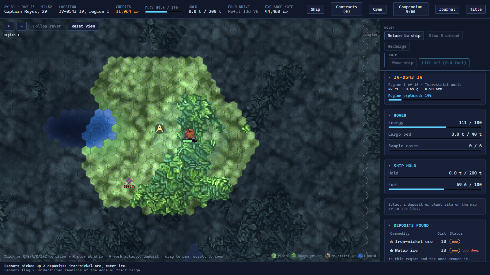
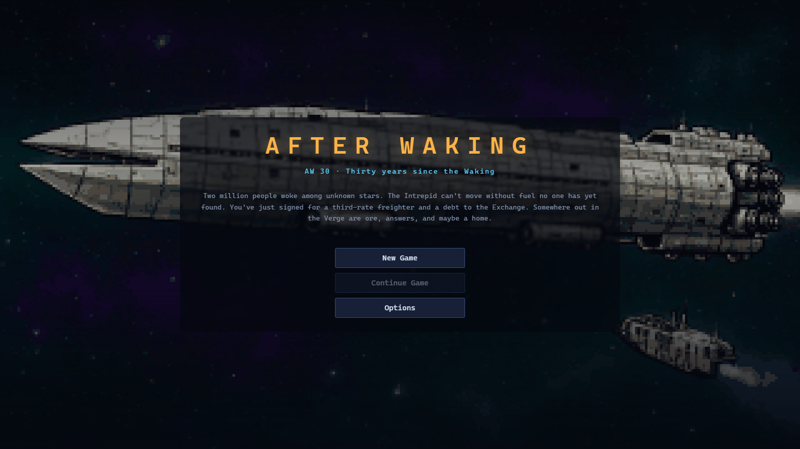
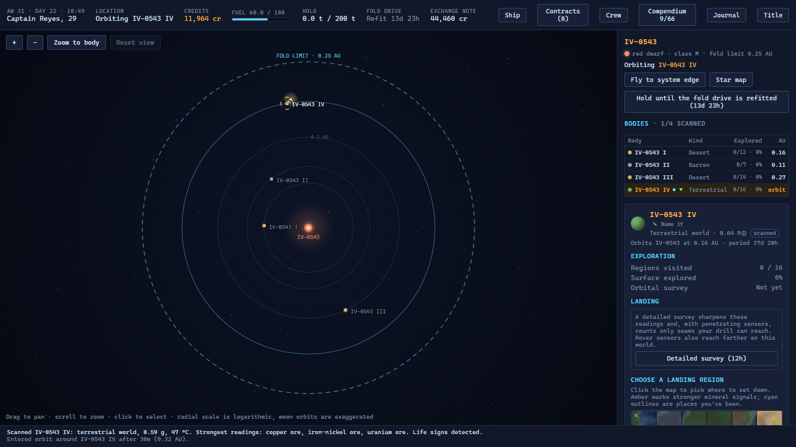
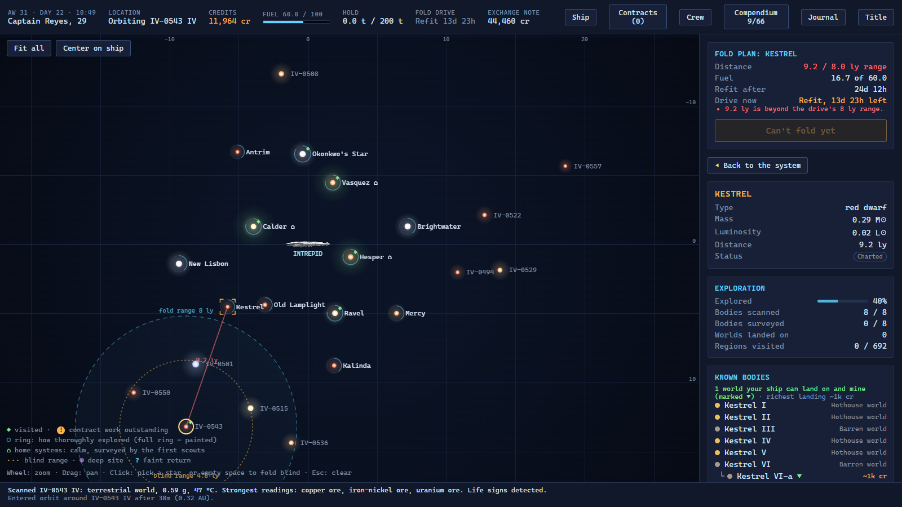

# After Waking

A space exploration and trading game in the spirit of the 1986 classic *Starflight*, played in the browser.

Two million colonists aboard the generation ship **Intrepid** were bound for Kepler-186. Two-thirds of the way there, the ship passed through a space-time anomaly and came out among unknown stars. Thirty years later the Intrepid is an anchored city-ship, and its people depend on a few independent captains who fold between the stars for fuel, ore and a new home. You've just bought your first ship, and you owe the Exchange for it.

> **Status: early development, but playable.** Saves may break between versions, the balance is still moving, and some systems are placeholders. Feedback is welcome.

### [▶ Play it in your browser](https://iron0037.github.io/after-waking/)

No install needed. Your game saves in that browser.



| | | |
|---|---|---|
|  |  |  |

## What you do

- **Fold** between stars instantly, then cross each system at a quarter of light-speed.
- **Scan** worlds from orbit, choose a region by its signal, land, and send out the rover. Drill seams, sample alien life, ferry a boat across the seas, and drop probes into gas giants.
- **Sell** at the Intrepid's Exchange and pay down your loan. Upgrade the ship at the Shipyard, take contracts from the clans, and commission research to unlock better gear.
- **Crew** of five humans who gain levels and talents. They have moods and loyalties, and they get older.
- **Raiders** wait on the routes out. You can pay, talk, run or fight a turn-based battle, take prizes, and hire the captives. If you'd rather not give orders yourself, your officers can fight for you.
- **Deep space.** With the right array you can fold into the dark between the stars and search it.
- **Mysteries** come from the Covenant, a clan who doesn't trust what it sees. They have errands for a captain who listens.

The Archive, the technical record that came with Earth's last transmission, explains each new system the first time it comes up. You can turn it off on the new-game screen or in the Journal.

## Running it locally

The [hosted build](https://iron0037.github.io/after-waking/) is the quickest way to play; it's rebuilt from `main` on every push. To run it yourself, you need [Node.js](https://nodejs.org/) 20 or newer.

```bash
npm install
npm run dev
```

Then open http://localhost:5173. On Windows you can double-click `play.bat` instead. It installs what's needed, starts the game, and opens your browser.

Games save automatically in the browser's local storage.

## For developers

| Command | What it does |
|---|---|
| `npm run dev` | Dev server with hot reload |
| `npm test` | Unit tests, plus a headless bot that plays full careers |
| `npm run typecheck` | Strict TypeScript check |
| `npm run build` | Production build into `dist/` |

The stack is TypeScript, [Preact](https://preactjs.com/), [Vite](https://vitejs.dev/) and [Vitest](https://vitest.dev/). Maps are drawn on 2D canvas.

- `src/sim/`: the game rules. These are pure, deterministic TypeScript with no DOM. The universe is regenerated from a seed and never saved; the save file is plain JSON.
- `src/data/`: content such as commodities, gear, perks, research and Archive entries.
- `src/ui/`: Preact components and screens.
- `tests/`: Vitest suites. `tests/bot.test.ts` plays whole trips headless. `BALANCE=1 npx vitest run tests/career.test.ts` prints a 60-trip career report.
- `tools/art/`: the scripts that generated the game's art (see below).
- `docs/`: design documents. **They contain spoilers for the story.**

`CLAUDE.md` is the project's working guide for the AI coding assistant used to build it. It also doubles as a short architecture overview.

## Art

The pixel art (terrain, crew portraits, the compendium and the title screen) was generated locally with Stable Diffusion XL. It used the Juggernaut XL checkpoint and the Pixel Art XL LoRA, then was curated and packed into atlases by the scripts in `tools/art/`. The process is described in `docs/art_pipeline.md`.

## Credits

Created by iron0037. Built with the help of Claude (Anthropic).

*Starflight* is a trademark of its respective owners. This is an independent fan-inspired project, not affiliated with or endorsed by them.

## License

No license has been chosen yet, so all rights are reserved for now. You're welcome to read the code and play the game.
